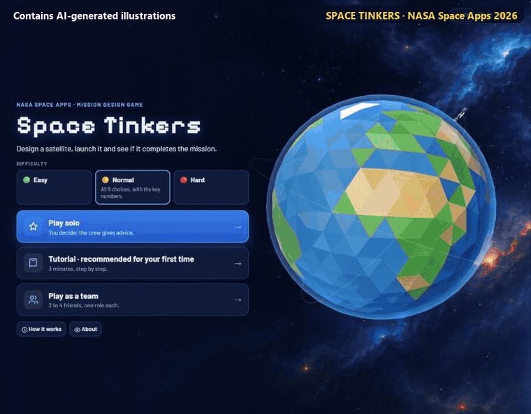

# Space Tinkers

## ▶ Play now: [spacetinkers.earth](https://spacetinkers.earth)

*Free, in the browser, no install or login. English, Português, Español.*

An educational game for the **NASA Space Apps Challenge 2026 — "Space Mission Design Game"**.
Players design a small satellite (a CubeSat) for a real customer need, on Earth, at the Space Station
or at the Moon, and learn that every choice costs something somewhere else: mass, power, budget,
data, comms and time.



*The GIF is a screen capture of the game. The illustrations in it were made with AI (see [Use of AI](#use-of-ai)).*

- For players aged about 12 and up. No prior space knowledge needed: every number has a plain-language
  sentence, a "See the math" box, and glossary tips on the technical words. Three difficulty levels.
- In **English** by default, also in **Português** and **Español** (flag buttons at the top).
- Solo or **cooperative team mode** for up to 4 players: each one owns some subsystems, everyone must say
  GO before the launch, and the team talks through quick shouts and a text chat.
- A **crew of characters** (Mission Director, Payload scientist, Spacecraft engineer, Communications,
  Mission manager), each caring about a different goal, and a **customer** (a fictional person per
  mission) who reacts to your design in every phase.
- Feels like a game: cockpit controls (levers, knobs, a big CONFIRM button), requirement cards that flip,
  a launch checklist with a red LAUNCH button, sound effects (one 🔊/🔇 button), and 0–3 stars at the end.

## How to play

Open the link above, or open `index.html` in a browser (double-click works). No install, no build, no login.

The game follows the 6 steps NASA uses to design and develop a science mission, shown as the
arrows at the top of the screen:

| NASA step | In the game |
|---|---|
| 1. Identify Need & Goals | In three scenes (customer → the mission → how to play), pick one of 8 missions: Amazon deforestation, Cerrado fire scars, urban growth, floods and weather in southern Brazil, docking with the Space Station, a hull inspector that flies around the Station, a lunar south pole mapper and a small lunar lander. Meet your crew and read the goals. A Mars mission and a space telescope are shown as "coming soon" |
| 2. Define Concept | **Scene mode**: one choice per scene, explained by the crew member in charge, with cockpit controls (an altitude lever for the orbit, a knob for the rest, a big CONFIRM button) and a live 3D preview. Or the full cockpit to choose orbit, launcher and ground station, with **Compare the orbits** |
| 3. Define Requirements | One **card per requirement**: the front says what the customer wants; flip it to see the number that proves it, the choices that move that number and how it will be verified |
| 4. Design | Scene mode (one part per scene, knob + CONFIRM, the satellite assembles in a 3D hangar) or the Mission Director's cockpit: parts in tabs by crew role, the *ripple effect* of each choice, the customer's goals and **crew advice**. Each instrument shows its **science value** for this customer (0–100) |
| 5. Build & Verify | A launch checklist: every requirement is checked; the four crew members vote **Go / No-Go**; **predict** how much data will reach Earth; pick the launch date; press LAUNCH. In a team room, **every player must say Go** first |
| 6. Implement | The launch plays in scenes (pad, Go/No-Go poll, countdown, liftoff, climb). A rocket that should not fly is **scrubbed on the pad**. Then the mission runs in 3D (stages separate, live telemetry, time warp, fullscreen). Moon missions fly the whole trip: parking orbit, translunar injection, a ~4-day cruise and lunar orbit insertion or landing. When a problem comes up, **mission control calls inside the 3D view with a 10-second countdown** |
| Mission Report | Score and **0–3 stars**, why things happened, your prediction vs. the result, a comparison with your previous attempt, **learning cards** (systems-thinking laws after Peter Senge) and **Sources & math** |

The 6 resources the challenge asks for are always on screen. Hover or focus an option to preview how it
would change each resource before choosing. After each choice, a short "chain of effects" line shows what
that choice changed.

Each customer needs a different satellite: every mission has at least two different winning
designs (checked by an automatic test), so players have to trade off rather than find one answer.

### A living mission with real space weather

In step 5 the player picks a launch date: **March 2019** (quiet Sun) or **March 2024** (solar maximum).
The mission then runs day by day for one year through the space weather NASA actually recorded in that
period (NASA DONKI, stored in `js/data/spaceweather.js`, so it works offline and without an API key):

- Real geomagnetic storms heat and swell the upper air: more drag, the orbit drops faster
  (and faster the lower it gets).
- Real solar particle events can reset the on-board computer and wear the solar panels.
- On-board memory fills with photos and empties during ground-station passes.
- When mission control gets an alert, or memory or power runs short, mission control calls inside the
  3D view with beeps and 10 seconds to answer. No answer means the satellite carries on as it is
  ("not deciding is also a decision"). The answer becomes the rule for the rest of the year.
  No countdown with "reduce motion" or when it is another player's turn in a team room.

The same design can succeed in 2019 and struggle in 2024. Charts and a mission diary (with links to each
real NASA event) show cause and effect over time.

### Team mode

"Play as a team" at the top. One person creates a room and shares the 6-letter code; the others
join with it (up to 4 players). Each player takes a role (Mission manager, Payload scientist, Spacecraft
engineer, Communications and ground) and can only change the choices of that role; whoever has no choice
in a phase watches a live **control tower**. The Mission manager moves the team between phases, and the
launch needs **GO from every player**. Players talk through **shouts** (ask a role for a missing part,
warn about a resource in the red) and a **text chat** (140 letters, 1 message per second, nothing saved).
The person who created the room is the host and keeps the official game state. Needs internet (PeerJS
public broker, only to introduce the browsers; game data goes directly between players).

## NASA resources

### Official resources of this challenge

The challenge page lists these 9 resources. The 5 we use appear in the game under
**Sources & math** (Mission Report), each with a link.

| Resource (as listed by the challenge) | Used? | Where and how |
|---|---|---|
| [Design and Develop Science Missions](https://www.nasa.gov/wp-content/uploads/2025/04/250323-design-and-develop-science-mission.pdf) (NASA, 2025) | **Yes, core** | The 6 phases of the game, the 4 mission segments (launch, space, ground, user) and "every requirement comes with a verification" (`js/data/phases.js`, Requirements cards, Build checklist) |
| [Concept Maturity Levels (CMLs)](https://dataverse.jpl.nasa.gov/dataset.xhtml?persistentId=hdl:2014/44299) (NASA JPL) | **Yes** | The CML 1–4 tag shown at each step (`js/data/phases.js`) |
| [CubeSat 101](https://www3.nasa.gov/sites/default/files/atoms/files/nasa_csli_cubesat_101_508.pdf) (NASA CubeSat Launch Initiative) | **Yes** | CubeSat sizes (U), the typical 18–24-month schedule and the ≥10% budget reserve (`js/data/catalog.js`, `js/data/scenarios.js`, crew advice) |
| [NASA Mission Viz](https://nasa.github.io/mission-viz/) | **Yes** | Its Earth image (`X3Dom/EarthImage.jpg`) became our 1° land/ocean/desert/ice map (`js/data/earthmask.js`) that paints the 3D planet, so the satellite really photographs the Amazon. Its orbit propagator is the reference for `js/viz/orbit.js` |
| [A Learning Game About Telescopes](https://science.nasa.gov/mission/webb/game-build-it-yourself/) (NASA Webb, "Build It Yourself") | **Yes, as inspiration** | Science goals drive the design, every option explains itself, an animated launch, then results (no data or code taken) |
| [Mission Design Lab (MDL)](https://etd.gsfc.nasa.gov/capabilities/integrated-design-center/mission-design-lab/) (NASA Goddard) | **Inspiration only** | The idea behind team mode: specialists in different disciplines design one mission together. Not cited in the game |
| [General Mission Analysis Tool (GMAT)](https://software.nasa.gov/software/GSC-19468-1) | No | A professional trajectory tool, too detailed for players aged 12. The game uses simplified circular orbits instead (see [What we simplified](#what-we-simplified)) |
| Visualize a Space Mission Using Virtual Reality (Space Apps 2023 challenge) | No | No VR. The same goal (see the mission concept, trajectory and timeline in 3D) is met in the browser by the 3D mission view |
| [CSA Digital Games and Activities](https://www.asc-csa.gc.ca/eng/youth-educators/digital-games-and-activities.asp) (Canadian Space Agency, partner) | No | — |

### Other NASA data and resources we use (not listed in the challenge)

| Resource | Where and how |
|---|---|
| [DONKI](https://ccmc.gsfc.nasa.gov/DONKI/) — Space Weather Database Of Notifications, Knowledge, Information (NASA CCMC) | Real storms, flares and solar particle events of 2019–2020 and 2024–2025 that hit the satellite day by day (`js/data/spaceweather.js`, `js/life.js`); each event in the mission diary links to NASA's page |
| [ISS Trajectory Data](https://spotthestation.nasa.gov/trajectory_data.cfm) (NASA) | The Space Station's typical orbit (418 km, 51.64°), drawn in the 3D view, used by the cargo-ship ride and by the two Space Station missions (docking and hull inspector) (`js/data/catalog.js`, `js/data/scenarios.js`) |
| [VIIRS](https://www.earthdata.nasa.gov/data/instruments/viirs) (NASA Earthdata) | Model for the wide-swath weather imager in the floods mission |
| [Lunar Reconnaissance Orbiter](https://science.nasa.gov/mission/lro/) (NASA) | Model for the polar lunar mapping orbits in the Moon missions |
| [Deep Space Network](https://www.nasa.gov/communicating-with-missions/dsn/) (NASA) | The big antennas used as ground station in the Moon missions |
| [Artemis I](https://www.nasa.gov/mission/artemis-i/) (NASA) | Carried 10 CubeSats toward the Moon: the model for the Artemis ride in the Moon missions |

**Sources & math** in the Mission Report lists these NASA sources too, and the 12 formulas the engine
calculates, each with what it means and the calculation for the player's own design.

## What we simplified

Numbers are realistic in order of magnitude but simplified for play: circular orbits, worst-case
shadow, approximate 2026 prices, rough orbital lifetimes, a simplified Earth–Moon trip. The game teaches
trade-offs, not exact engineering. Every formula is visible in the game under "See the math" and in
"Sources & math". The battery is part of the power system, and each satellite carries one instrument.

## Coming soon

Other mission types (a mission to Mars, a space telescope) are shown in the game as locked
"coming soon" cards. The engine reads missions from data (`js/data/scenarios.js`), so a new mission
is a new data entry, not a new game.

## Use of AI

Following the [Space Apps submission guide](https://www.spaceappschallenge.org/resources/project-submission-guide/),
this is where and how we used AI tools:

| What | AI used? | How it is marked |
|---|---|---|
| Code and text | Yes: AI assistants (Claude, by Anthropic) helped write code, game texts and translations. The team chose the idea and the design, reviewed everything and tested it (automatic tests in `tests.html`) | This section and the game's "About" screen |
| Illustrations (16 images in `assets/img`: menu sky, 8 customer cards, 7 phase banners) | Yes: generated with Higgsfield | A visible **"✦ AI image"** mark on each illustration in the game; this section |
| Demo GIF (`docs/demo.gif`) | No: screen capture of the game, assembled with ffmpeg. It shows the AI illustrations | The visible line "Contains AI-generated illustrations" on every frame |
| Demo video | Any AI-generated footage carries a visible watermark | Watermark in the video |
| Sound effects | No AI audio: the sounds are synthesized live by the game's code (WebAudio, `js/ui/sfx.js`), code written with AI help | This section |
| 3D models, characters, icons | No AI images: drawn by code (Three.js low-poly parts, SVG characters) written with AI help | This section |

No generated content uses NASA logos, flags or mission insignia.

## Open-source libraries and services

- [Three.js](https://threejs.org/) 0.147 (MIT) — 3D views, loaded from a CDN.
  Without internet the game still works, with a timeline instead of the 3D view.
- [PeerJS](https://peerjs.com/) 1.5 (MIT) — team rooms (uses the free PeerJS broker to connect players).
- [Google Fonts](https://fonts.google.com/): Barlow and Pixelify Sans (SIL Open Font License).
- Hosted on [Vercel](https://vercel.com/), at [spacetinkers.earth](https://spacetinkers.earth).

## For developers

Plain HTML + JavaScript, no build step and no dependencies to install.

- Tests: open `tests.html` (engine, state, screens, team rules, languages and game balance).
  Data typos also show up there as failed tests.
- Publish: any static host works (for example GitHub Pages from the repository root).

```
index.html            the game
assets/img/           the 16 AI-generated illustrations (menu, customers, phase banners); marked in the game
docs/demo.gif         the README GIF (screen capture of the game)
css/style.css         look and feel (colors in variables at the top; light/dark follows the system)
js/i18n/i18n.js       languages: MS.i18n.t('key'), MS.i18n.L({en,pt,es}), setLang('pt')
js/i18n/en|pt|es.js   interface and engine texts (same keys in all three; a test checks it)
js/data/phases.js     the phases: NASA step, segments, concept maturity, help texts
js/data/catalog.js    orbits, launchers, ground stations and components
js/data/scenarios.js  customers (scenarios): need, choices, requirements, verification, events, roles
js/data/glossary.js   glossary terms (tips on dotted words)
js/data/tutorial.js   steps of the optional guided tour (target on screen + text)
js/data/levels.js     difficulty levels: Easy (age 12+, 4 choices, tips), Normal (key numbers), Hard (battery, shielding, every number)
js/data/calcs.js      Hard mode "work it out yourself": mission equations solved with the player's own numbers
js/data/shouts.js     team shouts: ask a role for a missing part, resource warnings, quick lines, "everyone ready?"
js/sim.js             pure engine: MS.sim.run(state) → metrics, checks, requirements, mission, score
js/advice.js          pure crew advice: each role judges the design by its own goal (Go/No-Go),
                      prediction buckets, previous-attempt comparison, learning cards, the customer's
                      line per phase (client), orbit comparison and instruments' science value
js/levels.js          applies the difficulty level to a scenario (pure, tested)
js/life.js            pure day-by-day mission: altitude, memory, panels, battery + real space weather + decisions
js/data/spaceweather.js  real NASA DONKI events (2019–2020, 2024–2025)
js/state.js           single state + actions + localStorage (MS.store)
js/ui/core.js         header, steps, resource panel, previews, reusable pieces, clicks (data-action),
                      glossary and the "Sources & math" panel
js/ui/characters.js   the 5 crew characters drawn in SVG (with light, shadow, breathing and blinking) and the crew roster
js/ui/scene.js        scene mode: phase 1 in 3 scenes; Concept and Design one choice per scene with knob,
                      altitude lever and CONFIRM button; requirement cards that flip; the Build launch checklist;
                      phase intro cards; the team control tower (the full cockpit stays one click away)
js/ui/sfx.js          game sounds made live with WebAudio (no audio files): knob, CONFIRM, card flip, phase,
                      countdown, engine, abort siren, stars; one 🔊/🔇 button for the whole game
js/ui/chat.js         team text chat (only in a room): 140 letters, 1 message per second, last 30 kept by the host
                      for late joiners; nothing saved on any server
js/ui/coach.js        short teaching bubbles the first time each phase opens
js/ui/screen*.js      one screen per phase, registered with MS.ui.register(id, screen)
js/viz/looks.js       3D look of each catalog item, derived from its data (pure, tested)
js/viz/parts3d.js     low-poly 3D parts built in code (cards, hangar, mission view)
js/viz/hangar3d.js    3D hangar in the right column: the satellite assembled from the chosen parts
                      (Design) or the rocket on the pad / orbit / ground station (Concept)
js/viz/earth.js       reads the 1° Earth map (pure, tested); data in js/data/earthmask.js
js/viz/schedule.js    3D animation script (pure, tested)
js/viz/orbit.js       Keplerian orbit propagator, after NASA mission-viz's OrbitalPropagator (pure, tested)
                      (also the Hohmann transfer the cargo ship flies to reach the Space Station)
js/viz/mission3d.js   3D mission view (Three.js): staged launch, the Earth–Moon trip, the player's satellite, flight telemetry,
                      1×/5×/20× time warp, fullscreen, a trajectory colored by orbit status and the
                      mission-control alert with countdown
js/viz/launchscene.js ground launch scene in chapters: pad, Go/No-Go poll, countdown, liftoff, climb
js/net/team.js        team mode rules: roles and permissions (pure, tested)
js/net/room.js        room by code (PeerJS): the host validates actions and broadcasts the state; relays shouts,
                      the ready check (team GO) and the chat
js/net/shouts.js      shout rules: which shouts make sense now, text in each player's language, validation (pure, tested)
js/ui/team-panel.js   team panel and notifications
js/ui/shouts-ui.js    Shout button, big alert with sound and screen shake, ready check bar
js/ui/calcs.js        Hard mode equation panel: given data, answer check (±3%), step-by-step solution
js/ui/menu.js         start menu (play solo / team / tutorial / how it works) with a light 3D Earth behind it
js/ui/tutorial.js     guided tour: spotlight + bubble over an example design (the player's design is untouched)
js/ui/mission-life.js launch date, decision cards, day-by-day charts and mission diary
js/main.js            connects interface and state
```

Architecture rule: screens only **read** `MS.store.state`, only **change** it through actions,
and compute results with `MS.sim.run(state)`. The state stores choices and progress only;
results are always recomputed. The language belongs to each player and is not part of the state.

### Where to add things

| New thing | Where |
|---|---|
| Text shown in the interface | a key in `js/i18n/en.js`, `pt.js` and `es.js` |
| Text inside the data | `T('english', 'português', 'español')` |
| Component, orbit, launcher, station | `catalog.js` + its id in the slot `options` in `scenarios.js` |
| Requirement | `scenarios.js` → `requirements` (metrics in `MS.sim.metricDefs`) |
| Mission event / random event | `scenarios.js` → `events` / `randomEvents` (drawn from `state.seed`) |
| Customer (scenario) | `variant('id', {...})` in `scenarios.js` (changes only what differs from the base) |
| Help text of a phase | `phases.js` → `guide`, `tips`, `nasa` |
| Glossary term | `glossary.js`; in data texts use `[[key]]` or `[[key\|text]]` |
| Difficulty level | `levels.js` → budget/deadline/margin/chance factors, fixed or following choices, tips, extra slots and events |
| Tutorial step | `tutorial.js` → `steps` (`phase`, `target` CSS selector, `title`, `text`); a test checks that every target exists |
| Team role | `scenarios.js` → `team.roles` |
| Crew advice or a learning card | `js/advice.js` (`crew`, `cards`) + texts `crew.*` / `card.*` in the 3 languages |
| Customer person or their lines | `contact` in `scenarios.js` + `client` in `js/advice.js` + texts `cl.*` |
| A formula in "Sources & math" | `SRC_MATH` in `js/ui/core.js` + texts `src.f.*` in the 3 languages |
| 3D look of an item | derived from its data in `js/viz/looks.js`; override with a `look: {...}` field on the catalog item |
| New kind of 3D model | a builder in `BUILDERS` in `js/viz/parts3d.js` + its name in `MS.looks.KINDS` |
| New physics, metric or check type | `sim.js` (`METRICS` + `computeMetrics`, `CHECKS` + `computeChecks`) |

After changing data, run `tests.html`: the validation test points to missing fields or wrong ids,
and the balance test checks that each customer still has at least two winning designs.
